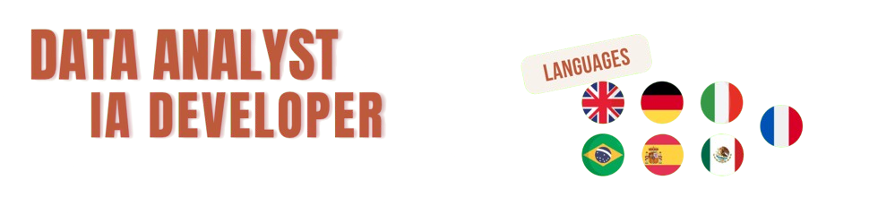
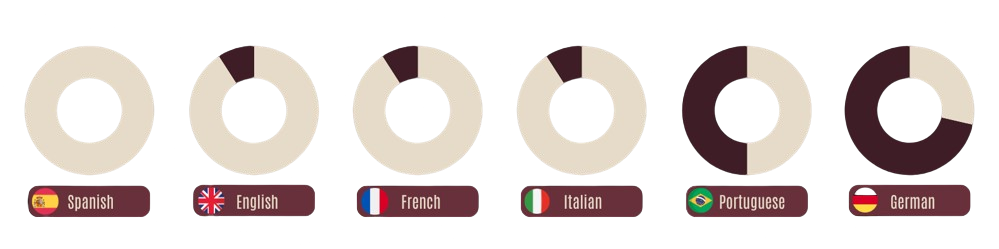

<h1 align="center">
Hello there 👋

Welcome to my GitHub profile! 
</h1>

<h3> 

I’m a <strong> Data Analyst </strong> with a background in business operations, supply chain, and international projects. I enjoy turning complex data into clear insights and bridging technical and business perspectives. Highly adaptable and curious, I thrive in collaborative, cross-functional environments. Currently deepening my skills in <strong> AI </strong>  and always eager to collaborate on projects where data meets people, strategy, and impact.

</h3> 

 
 

<h2 align="center"> 
This is how I could help you:
</h2>
<h2 align="center"> 
    ⭐
</h2>

- I help organizations adopt AI in a way that is responsible, measurable and built to last.

- I start from the business problem, map how the process really works, and decide whether the answer is AI, automation or a simpler workflow.

- I build the solution with the people who will use it, train them, and measure whether it delivers.

- My focus is AI governance: designing the frameworks, policies and controls that let companies use AI safely, with clear ownership and evidence of value.

- I work between business, data and technology, and I speak to each one in its own language.

- Plus, I speak fluently Spanish, English, French and Italian, I have a B2 level in Portuguese, and I really do love languages.

  
  &nbsp;
  

---
 
 
 

<h2 align="center" > 
⚙️ Tech Stack Overview
</h2>

| Data & Backend | Databases | BI & Visualization | AI & Governance | Cloud & DevOps | Business & Delivery |
|---|---|---|---|---|---|
|  |  |  |  |  |  |
|  |  |  |  |  |  |
|  |  |  |  |  |  |
|  |  |  |  |  |  |
|  |  |  |  |  |  |
| -61DAFB?logo=react&logoColor=black) |  |  |  |  |  |
|  |  | |  |  |  |
|  | | |  |  |  |
|  | | | | | |
|  | | | | | |
|  | | | | | |
|  | | | | | |
|  | | | | | |
|  | | | | | |

---

<h2 align="center" > 
🗣️ Languages I speak
</h2>

---

<h2 align="center" > 
📌 Highlighted Projects
</h2>

  
  &nbsp;
  
  &nbsp;
  
  &nbsp;
  
  &nbsp;
  
  &nbsp;
  

